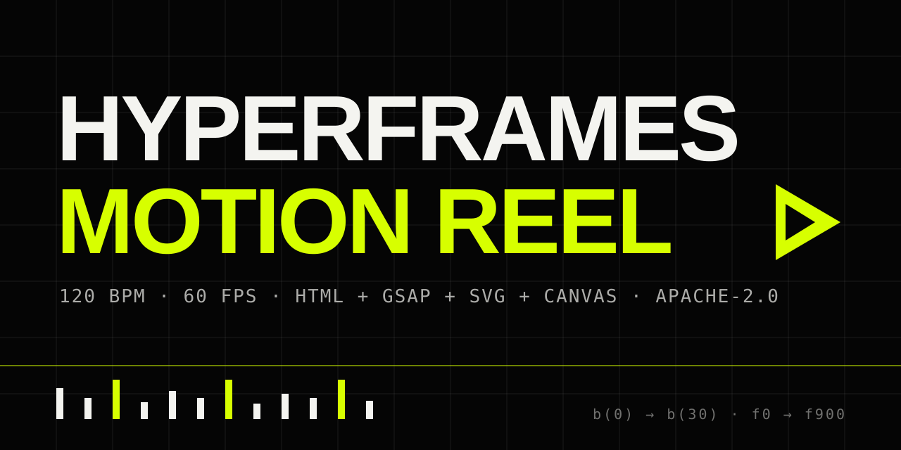

<div align="center">
  
  <h1>HyperFrames Motion Reel Skill</h1>
  <p><strong>Showreel-grade motion graphics, written as code.</strong><br>
  A Claude Code skill that turns a one-line theme into a beat-synced, render-ready HyperFrames video.</p>
  <p>
    
    
    
    
    <a href="https://github.com/Sunwood-ai-labs/hyperframes-motion-reel-skill/actions/workflows/ci.yml"></a>
    <a href="./LICENSE"></a>
  </p>
  <p>
    <a href="./README.md"></a>
    <a href="./README.ja.md"></a>
  </p>
</div>

`hyperframes-motion-reel` directs Claude Code to act as a senior motion designer and creative coder. From a short theme (plus optional images or voice), it expands a world, copy, design system, beat-by-beat timeline and generated score — then implements, checks, snapshots and renders an MP4 with [HyperFrames](https://www.npmjs.com/package/hyperframes).

It is the HyperFrames port of `remotion-motion-reel`: same creative bar, but built only from Apache-2.0 / free tooling, so **no Remotion Company License** is needed for commercial work at any company size.

## ✨ Features

- **Showreel creative direction** — bold typography, fast transitions, depth, parallax, particles and camera moves; plain fade-in chains are banned
- **Beat-locked timing** — every cut and impact is written as `b(n)` on a 120 BPM / 60 FPS grid (1 beat = 0.5 s = 30 frames)
- **Two-layer animation architecture** — one paused GSAP timeline for choreography + a pure `render(t)` function for generative Canvas/SVG layers (seek-safe)
- **Code-generated sound** — kick, hi-hat, impact, rise and sub bass written as WAV with Node.js built-ins only, driven by the same beat table as the picture
- **Morphing transitions** — shapes carry over between scenes (type → line → graph → 3D grid → tunnel → logo) instead of cross-fades
- **Deterministic rendering** — seeded PRNG, no `Date.now()` / `Math.random()`, stable across parallel render workers
- **Full verification loop** — `lint` → `check` (0 findings) → `snapshot` review → `render` → `ffprobe` / `ffmpeg` frame spot-checks

## 🚀 Quick Start

### 1. Install the skill

```bash
git clone https://github.com/Sunwood-ai-labs/hyperframes-motion-reel-skill ~/.claude/skills/hyperframes-motion-reel
```

On Windows (PowerShell):

```powershell
git clone https://github.com/Sunwood-ai-labs/hyperframes-motion-reel-skill "$env:USERPROFILE\.claude\skills\hyperframes-motion-reel"
```

The skill loads the HyperFrames domain skills (`/hyperframes-core`, `/hyperframes-animation`, `/hyperframes-keyframes`, `/hyperframes-creative`, `/hyperframes-registry`, `/hyperframes-cli`, `/hyperframes-audio`) during the build, so install those alongside it.

### 2. Requirements

- Node.js (current LTS) and `npx`
- Google Chrome (used by the HyperFrames renderer)
- `ffmpeg` / `ffprobe` on `PATH` for final verification

### 3. Run it

```text
/hyperframes-motion-reel Neon Tokyo night drive, 20 seconds, BPM 128
/hyperframes-motion-reel Product launch teaser for an AI camera, vertical 9:16
/hyperframes-motion-reel ./assets/character.png ./assets/voice.wav character intro reel
```

Durations, BPM, resolution, aspect ratio and assets given in the prompt override the defaults.

## ⚙️ Default Parameters

| Parameter | Default | Notes |
| --- | --- | --- |
| Duration | 15 s | Snaps to the beat grid; follows voice length when voice is supplied |
| FPS | 60 | `npx hyperframes render --fps 60` |
| BPM | 120 | 1 beat = 0.5 s = 30 frames |
| Size | 1920 × 1080 | 1080 × 1920 for vertical, 1080 × 1080 for square |
| Output | MP4 / H.264 | draft and delivery quality presets |

## 🧭 Workflow

1. Concept — one sentence
2. Design system — written to `DESIGN.md`
3. Timeline — seconds, beats and frame numbers (`b(8) = 4.0s = f240`)
4. Motion design — named HyperFrames blueprints and rules per scene
5. Sound design — generated by `scripts/generate-audio.mjs`
6. Implementation — `npx hyperframes init` → HTML / GSAP / Canvas
7. Validation — `npx hyperframes lint` and `npx hyperframes check` to 0 findings
8. Snapshot review of every scene peak
9. Render — `npx hyperframes render --fps 60 --quality delivery`
10. `ffprobe` / `ffmpeg` spot-checks of the final MP4

## 🗂️ Generated Project Layout

```text
<project-dir>/
|- hyperframes.json
|- DESIGN.md
|- index.html              # root composition (data-width / data-height / data-duration)
|- compositions/           # hard-cut scenes only
|- src/
|  |- config.js            # CFG: FPS, BPM, size, colors, beat table
|  |- lib.js               # b(), mapRange, spring, seeded random
|  `- particles.js         # pure render(t) for Canvas
|- scripts/
|  |- generate-audio.mjs   # Node built-ins only -> assets/audio/score.wav
|  `- sync-config.mjs      # CFG -> root data-* attributes
`- assets/
   |- audio/score.wav
   `- fonts/
```

## 📦 Repository Layout

```text
hyperframes-motion-reel-skill/
|- SKILL.md                # the skill itself (loaded by Claude Code)
|- README.md
|- README.ja.md
|- LICENSE
|- .github/workflows/      # CI (markdownlint + docs build) and Pages deploy
`- docs/                   # bilingual VitePress site
```

## ⚖️ Licensing

- This skill repository: [MIT](./LICENSE)
- HyperFrames (`hyperframes` on npm): Apache-2.0 — free for commercial use at any company size
- GSAP 3: free, including commercial use
- The skill never introduces libraries that require paid licenses. By contrast, Remotion requires a paid Company License for for-profit companies with four or more employees.

## 📚 Documentation

- English docs: [sunwood-ai-labs.github.io/hyperframes-motion-reel-skill](https://sunwood-ai-labs.github.io/hyperframes-motion-reel-skill/)
- Japanese docs: [sunwood-ai-labs.github.io/hyperframes-motion-reel-skill/ja/](https://sunwood-ai-labs.github.io/hyperframes-motion-reel-skill/ja/)
- Local preview:

```bash
cd docs
npm install
npm run docs:dev
```

## 🔗 Related

- [hyperframes-skill](https://github.com/Sunwood-ai-labs/hyperframes-skill)
- [hyperframes-cli-skill](https://github.com/Sunwood-ai-labs/hyperframes-cli-skill)
- [hyperframes-registry-skill](https://github.com/Sunwood-ai-labs/hyperframes-registry-skill)
- [website-to-hyperframes-skill](https://github.com/Sunwood-ai-labs/website-to-hyperframes-skill)
- [gsap-skill](https://github.com/Sunwood-ai-labs/gsap-skill)
