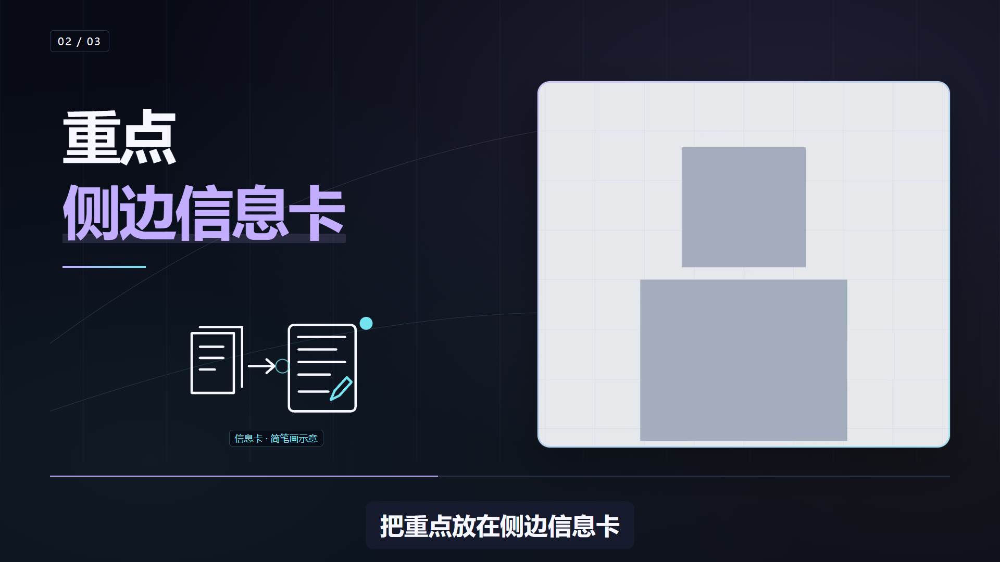
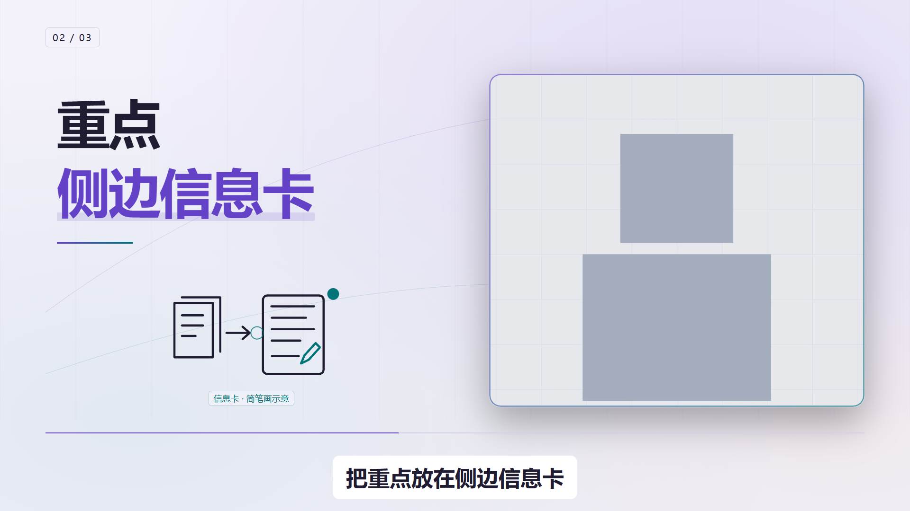
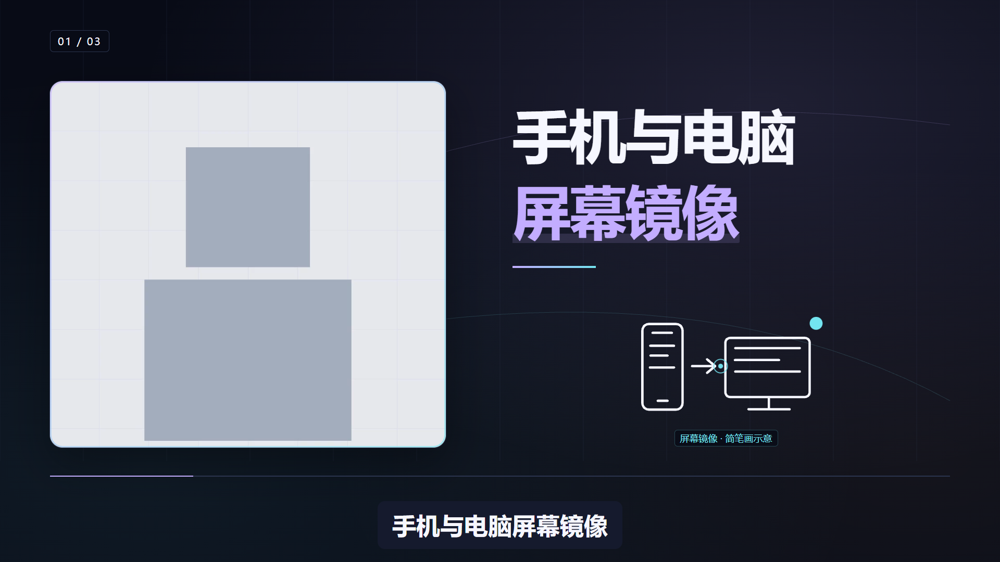

# AI Self-Media Video Packaging Skill

**把口播视频和字幕交给 AI，让它帮你完成画面包装。**

这是我创建的一套 AI 口播视频包装 Skill，适合知识分享、AI 工具介绍和教程讲解。它会根据你说的内容，设计标题、重点信息、流程图和简笔画，让人物画面与辅助信息配合出现，而不只是给视频加一层字幕。

你不需要自己写代码或逐个调整动画：在 Codex 或支持本地文件、终端操作的 AI Agent 里安装好项目，把 **MP4 视频和对应的 SRT 字幕**交给它，用大白话描述需求即可。AI 先给你看方案，确认后再制作、检查和导出。

## 能帮你做什么

- **突出重点**：把口播里的关键词、要点和流程变成清楚的画面信息。
- **丰富画面**：搭配人物窗口收放、适度推近，以及帮助理解内容的简笔画和动效。
- **统一风格**：选择深色或浅色，让配色、文字和图形保持一致。
- **交付成片**：按确认的方案输出带包装的 MP4，并检查字幕、遮挡和文件完整性。

保留你的视频、原声和完整字幕，把重点讲得更清楚。动效是为内容服务，不是每句话都塞一个特效。

## 怎么用：复制两段话就可以开始

### 1. 让 AI 帮你安装

在 Codex 或其他具备本地执行能力的 AI Agent 中，新建一个对话，复制下面这段话：

```text
请帮我安装并配置这个 AI 口播视频包装 Skill：
https://github.com/zhouyuechuan2025-ui/ai-self-media-video-packaging-skill

先读取仓库的 README.md 和 SKILL.md，再按当前 Agent 的方式安装。
保留完整项目，不要只复制 SKILL.md；检查并准备项目所需依赖。
不要覆盖我已有的同名项目或 Skill，遇到冲突先告诉我。
完成后检查是否能调用，并告诉我接下来把视频和字幕放在哪里。
```

第一次需要准备运行环境，后面可以复用。同一段安装提示词不代表所有 Agent 都已测试兼容；仅能聊天、不能读取本地文件或运行命令的工具无法直接制作视频。

### 2. 把 MP4 和 SRT 交给它

把文件添加到对话，或告诉 AI 它们在电脑里的位置，再发：

```text
请用刚安装的口播视频包装 Skill，处理我提供的 MP4 和对应 SRT。
先理解文稿，按内容安排标题、重点信息和必要的简笔画。
整体风格简洁、有设计感，不遮挡人物和字幕，保留原声，不改写原意。
先给我看包装方案，等我确认后再制作预览；最终导出前再让我确认。
最终需要一个带包装的 MP4，不要覆盖我的原视频。
```

你也可以补充一句：“用浅色风格”“这段重点展示流程”或“动效少一点，优先保证看得清楚”。不满意的地方直接在对话里提出，继续调整即可。

**交素材 → 确认方案 → 看预览并修改 → 确认导出。** 不需要普通用户手动输入下面的命令。

## 前期素材准备

先剪好原片与对应字幕。本 Skill 负责画面包装，**不处理重读、漏读和气口**，不重排讲解，不追加原稿没有的数字、操作步骤或结论。目前支持 **16:9 横屏**，竖屏暂不支持。

- **视频 + SRT**：默认推荐，直接合成 MP4，检查真人位置与字幕。
- **只提供 SRT**：按明确的画布尺寸生成透明 MOV，不能据此判断真实人物是否被挡。

字幕模式：

- 原视频已经带有字幕（字幕已固定在画面中）：`--captions burned-in`。
- 原视频没有字幕，希望 Skill 自动生成字幕：`--captions generated`。
- 原视频没有字幕，并且只需要动效、不需要字幕：`--captions none`。

启用真人轻推近时，原视频底部字幕会由当前SRT重绘，保证内容完整，不叠两层字幕。若SRT与原声不同步，先修复输入。

## 给 AI Agent 和开发者的技术说明

普通用户读到这里就可以开始使用了。以下是手动安装、命令和检查细节，供 AI Agent 或开发者参考。

<details>
<summary>展开手动安装与运行命令</summary>

需要Node.js 20+、FFmpeg和ffprobe。当前支持16:9横屏输入，透明输出也使用16:9画布。

```bash
git clone https://github.com/zhouyuechuan2025-ui/ai-self-media-video-packaging-skill.git
cd ai-self-media-video-packaging-skill
npm ci
```

四步逐级审核；下列命令的输入与风格必须保持一致：

```bash
# Gate A：只写方案
npm run package-video -- --video INPUT.mp4 --srt INPUT.srt --out RUN --output-mode composite --captions burned-in --style dark
# Gate B：制作工程输入
npm run package-video -- --video INPUT.mp4 --srt INPUT.srt --out RUN --output-mode composite --captions burned-in --style dark --approve-gate-a --approve-gate-b
# Gate C：8个时间轴抽帧，人工检查，不导出最终视频
npm run package-video -- --video INPUT.mp4 --srt INPUT.srt --out RUN --output-mode composite --captions burned-in --style dark --approve-gate-a --approve-gate-b --approve-gate-c
# Gate D：完整MP4与验收记录
npm run package-video -- --video INPUT.mp4 --srt INPUT.srt --out RUN --output-mode composite --captions burned-in --style dark --approve-gate-a --approve-gate-b --approve-gate-c --approve-gate-d --render
# 透明MOV，画布需与目标工程一致
npm run package-video -- --srt INPUT.srt --out RUN --output-mode overlay --width 1920 --height 1080 --fps 30
```

所有阶段可用 `--style paper`。合成MP4默认使用 `--presenter-layout single`，人物以唯一连续视频参与构图；`--presenter-layout original`保留原有侧卡方式。需要全幅画面的轻推近时，添加 `--presenter-motion subtle`，默认 `off`。透明输出只支持 `original`，不包含真人原片。当前工作流使用Remotion；HyperFrames适配器用于维护已有V2工程。

Agent应先逐句分析语义，并用 `--direction DIRECTION.json` 提炼原句关键词与构图意图。该文件按SRT序号指定 `mode`、`lines`、可选 `eyebrow` 和 `highlight`，每个上屏词必须原样出现在对应原句中。它只描述展示方式，不改字幕、原声或源视频。示例见 [direction.json](examples/current-demo/direction.json)。所有审核阶段保持相同输入和参数。

需要简笔画时，在相应方向条目中加入 `"doodle": {"type": "phone-mirror", "label": "屏幕镜像"}`。标签必须取自该句原稿；图形是概念示意，不是真实设备操作或截图。当前简笔画用于单窗合成MP4，图形区与文字、人物和字幕分开。支持的类型见 [功能与限制](references/public-lite.md)。

v0.6细化了动效与排版：每页先建立构图，再揭示重点，描线后给出一次流动提示，随后保持阅读停留。辅助色按语义分工，不逐句随机换色。真人原色与唯一原声保持不变。

</details>

## 检查与限制

<details>
<summary>展开交付检查与技术边界</summary>

```bash
npm test
npm run typecheck
npm run build
npm run verify:public
```

检查源文件哈希、文字与脸部安全区、字幕、首尾和转场、完整解码、黑帧与输出哈希。抽帧、构建成功和解码通过都不能替代完整播放或用户验收。

居中人物使用左右安全区，底部18%预留字幕；单窗模式裁掉源字幕区域并从SRT完整重绘一次，文字与人物分栏。原始构图模式的全屏标题与流程使用不透明底色。三种语义版式不需要凑八种结构，长片也应按语义编排。两套风格逐片统一，标题取原稿关键词，超长句保留完整字幕。

详细规则：[功能与限制](references/public-lite.md)、[审核阶段](references/gates.md)、[画面检查](references/visual-quality-gates.md)。

</details>

## 当前示例：三版式与两种配色

以下截图由本项目当前渲染器生成，使用可复现的合成测试画面与示例文案，不是真人口播案例，也不作为外部事实的证据。







示例字幕与生成方法见 [示例目录](examples/current-demo/README.md)。

## 当前简笔画示例



此图由当前代码与示例文案生成。首页不再使用旧V2案例截图；真人素材与试看片留在本地，上面的公开示例明确使用合成画面。

## 视频做好了，生意才刚开始

我是 nana，正在做 AI 自媒体和 AI 企业服务。我的抖音账号两个月涨粉 3.4 万，累计变现六位数。这套 Skill 来自我自己的内容创作实践，是帮助我提高视频制作效率的工具。

但视频包装出来了，不代表账号就能做起来，更不代表能持续赚钱。AI 能帮你提效，最终还是要回到业务本身：你服务谁、帮他们解决什么问题，怎样通过内容建立信任，以及后面用什么产品和服务承接需求。我的账号增长和变现，也不能简单归因于一个工具或一套 Skill。

如果你想继续学习，我这边有两个产品：

- **199 元域新AI社群终生会员**：适合想从0-1学习 AI、了解实际应用的人。内容包括基础 AI 知识，以及不同 AI 项目的分析、经验和应用分享。
- **AI 自媒体真人商业 IP 全年陪跑服务（1v1）**：适合想把 AI 自媒体做成一门业务的人。围绕你的背景和资源，从账号定位、起号与内容创作，到引流、个人 IP 建设，再到后端产品设计与商业体系搭建，提供一对一指导，帮你把这些环节串起来。

感兴趣的朋友欢迎咨询业务微信：nanaya093


