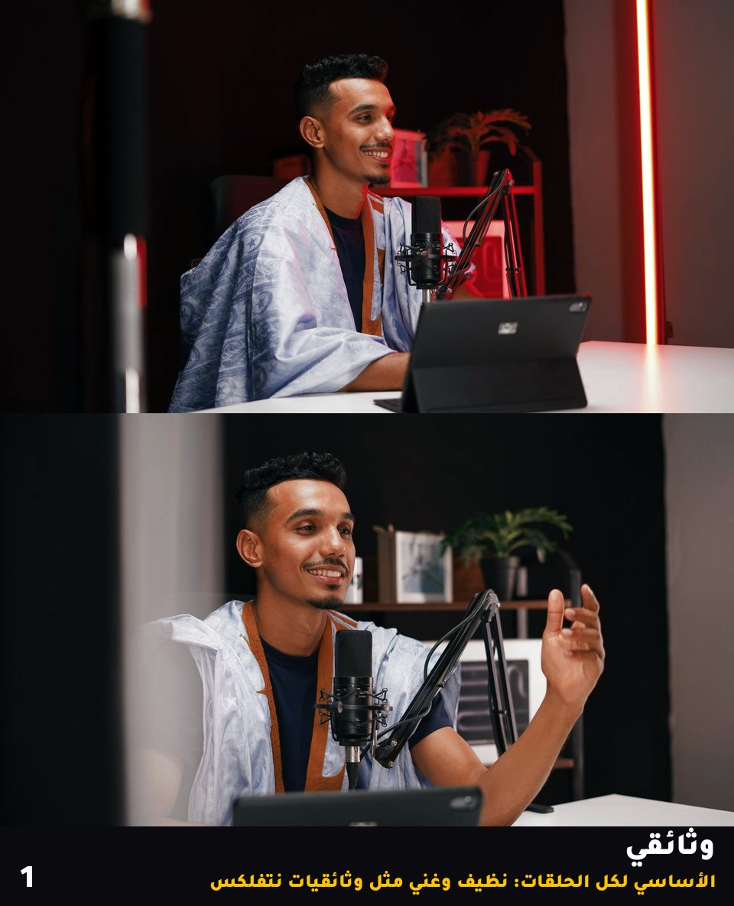
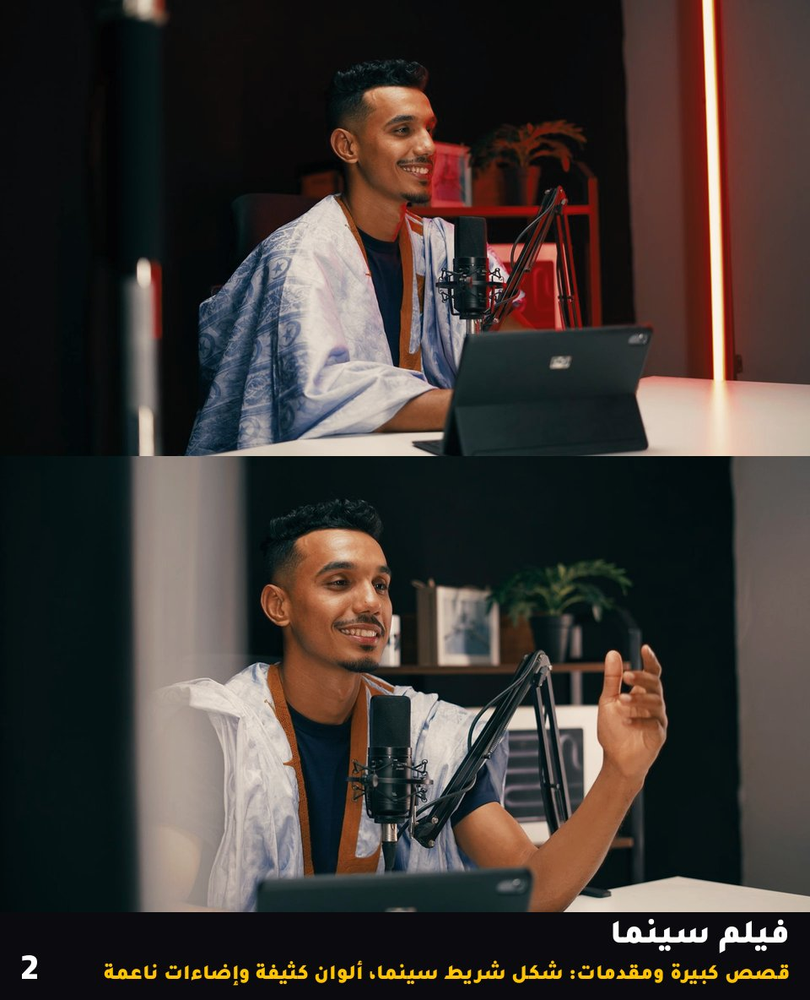
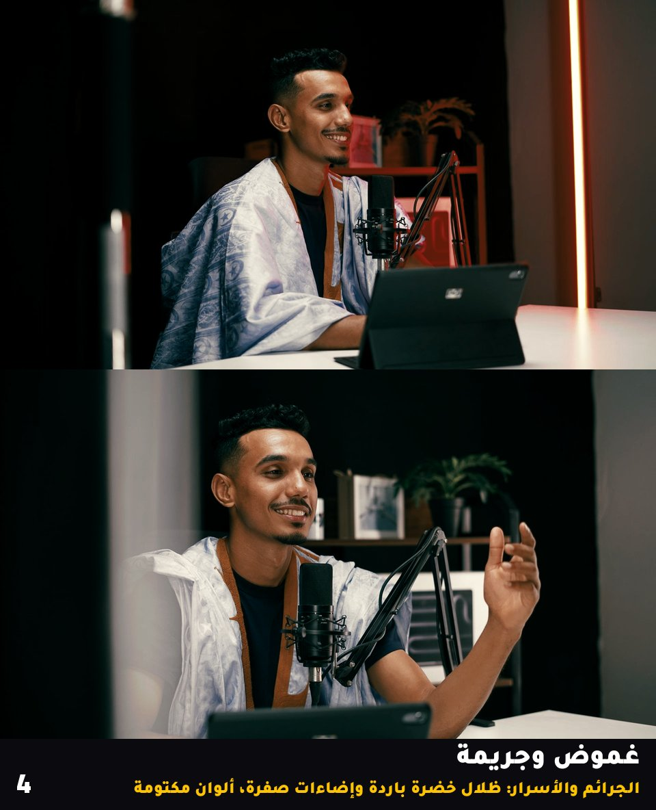
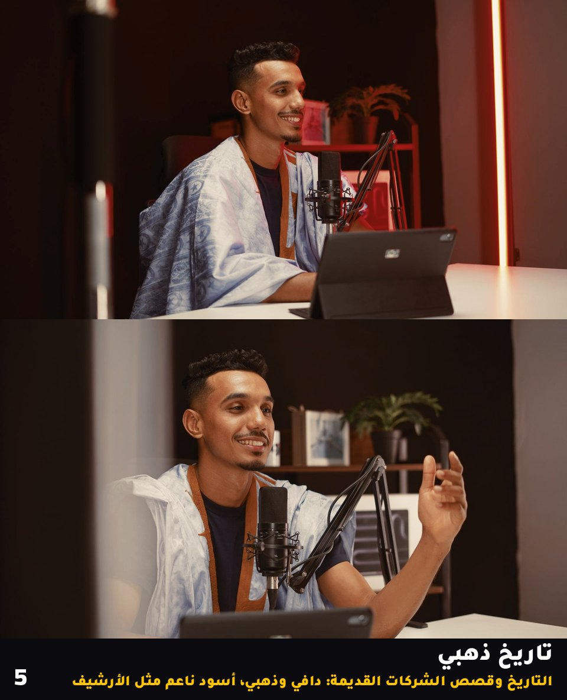
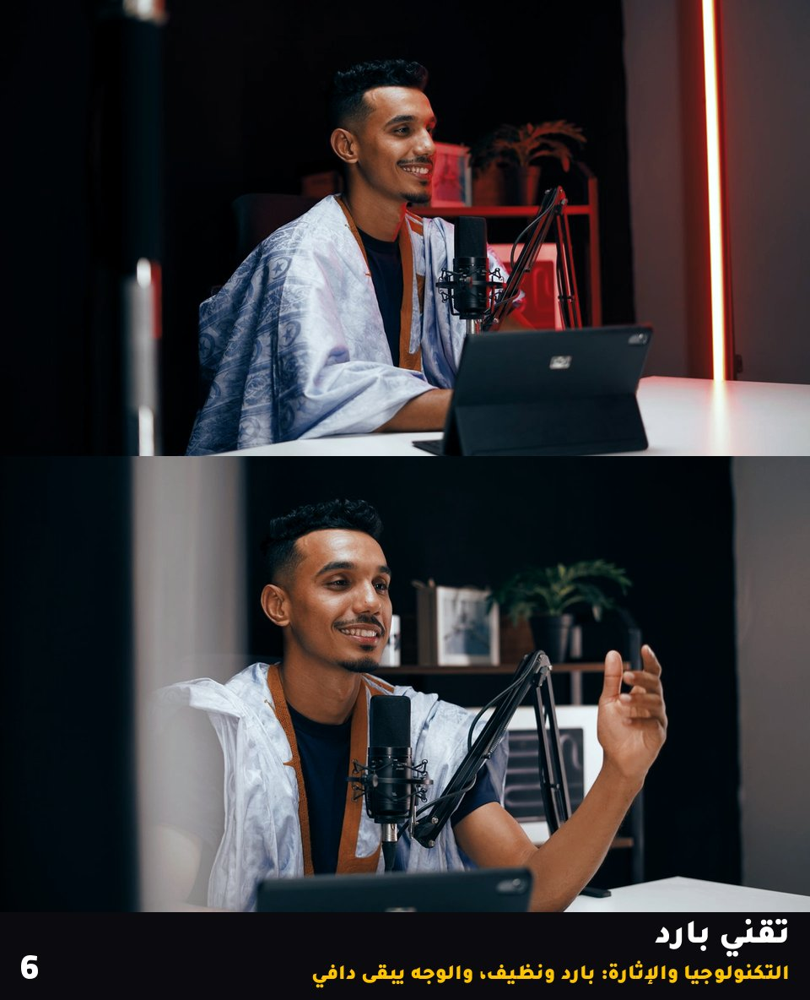
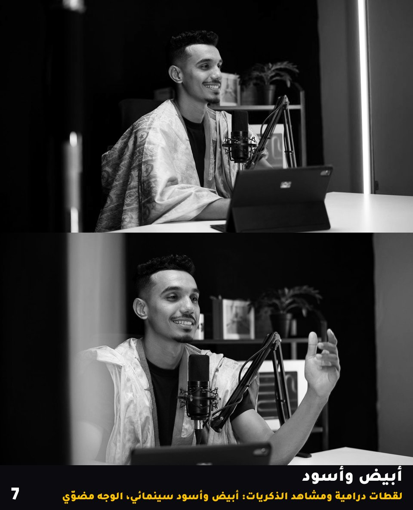
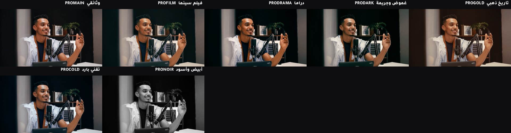

# الكاميرا من الألف للياء (Sony ZV-E10 II)

تضبطها **مرة وحدة**. بعدها كل يوم: **تشغّل ← تختار MR 1 ← تدوس تسجيل.** والفيديو يطلع ملوّن وجاهز: تقص وتنزل، بلا تصحيح ألوان.

📱 **تطبيق الإعداد (الأسهل):** صفحة بالعربي على موبايلك، خطوة وحدة بالشاشة: `app.html` (منشورة كصفحة خاصة إلك).

💻 **تطبيق الماك «كاميرتي»:** `mac.zip`. تدخّل الكارت وتفتحه، ويسوي كلشي وحده بنوافذ عربية: يحط الفلاتر السبعة، ويحفظ إعدادات الكاميرا بالماك أول مرة، ويرجّعها للكارت إذا انمسحت. أول مرة بس: كليك يمين ← Open (أو من الإعدادات ← الخصوصية والأمان ← Open Anyway).

🎬 **فيديو الشرح (بصوت عراقي):** [guide-video.mp4](guide-video.mp4). شغّله على الموبايل وطبّق ويا خطوة بخطوة.

---

## الفلاتر السبعة

> **شنو يعني فلتر (LUT)؟** ملف صغير يگول للكاميرا "هذا اللون حوله لهذا اللون". الكاميرا تطبعه داخل الفيديو وقت التصوير.

| الصورة | الملف | الستايل | متى | مكانه بالكاميرا |
|---|---|---|---|---|
|  | `1` | **وثائقي** | الأساسي لكل الحلقات. نظيف وغني مثل وثائقيات نتفلكس | PPLUT1 |
|  | `2` | **فيلم سينما** | القصص الكبيرة والمقدمات | PPLUT2 |
|  | `3` | **دراما** | قصص بيها صراع وتوتر | PPLUT3 |
|  | `4` | **غموض وجريمة** | الجرائم والأسرار | PPLUT4 |
|  | `5` | **تاريخ ذهبي** | التاريخ وقصص الشركات القديمة | User5 (تبدّله وقت تحتاجه) |
|  | `6` | **تقني بارد** | التكنولوجيا والإثارة | User6 |
|  | `7` | **أبيض وأسود** | لقطات درامية وذكريات | User7 |

- **ما تعرف شتختار؟ الفلتر 1 دائماً.**
- كلهم يحمون **وجهك أول شي**: البشرة طبيعية وتفاصيل الوجه واضحة، شنو ما چان لون ضوء الخلفية (أحمر، أزرق، بنفسجي، أبيض).
- الفلاتر القديمة بمجلد `luts/archive`. **لا تحطها بالكاميرا.**

*(صور المعاينة من موقع Pexels المجاني، ومطبّق عليها الفلتر بالحساب.)*

---

## الإعداد (مرة وحدة، بالترتيب)

### 1) الكارت
- كارت SD مكتوب عليه **V30** أو أعلى (V60 أحسن).
- انقل أي شي عليه للموبايل، وبعدين فرمته **بالكاميرا**: `MENU > Shooting > Media > Format`

### 2) النظام: NTSC
`MENU > Setup > Area/Date > NTSC/PAL Selector > NTSC`
- **ليش؟** بهذا النظام بس تنفتح أحسن جودة بأصغر حجم (الخطوة 4).
- الكاميرا تطفي وتشتغل وتطلب فرمتة: وافق.
- **الضوء ما يرمش** رغم إن كهرباء العراق 50 هيرتز، لأن الغالق راح يكون 1/50.

### 3) نوع الملف
`MENU > Shooting > Image Quality/Rec > File Format > XAVC HS 4K`
- **XAVC HS** = ضغط حديث (يسمونه H.265): نفس الوضوح بنص الحجم.

### 4) الفريمات والجودة
`Movie Settings > Rec Frame Rate > 24p`
`Movie Settings > Record Setting > 30M 4:2:0 10bit`
- **24p** = 24 صورة بالثانية، شكل السينما والوثائقيات.
- **10bit** = ألوان أنعم، بلا تكسّر ولا خطوط بالخلفية الغامگة. هاي الي تمنع "تكسير البكسلات".

| مدة التصوير | الحجم تقريباً |
|---|---|
| 10 دقايق | 2.3 گيگا |
| 20 دقيقة | **4.5 گيگا** |
| 30 دقيقة | 6.7 گيگا |

> **تريد كل ملف أقل من 5 گيگا؟** وگّف التسجيل وابديه من جديد كل 20 دقيقة.

### 5) النسخة الصغيرة: طفّيها
`MENU > Shooting > Image Quality/Rec > Proxy Settings > Proxy Recording > Off`
- إذا شغّالة، تنتقل نسخة ضعيفة للموبايل وتحس الفيديو مكسّر.

### 6) الوضع اليدوي (أهم خطوة)
- زر الوضع فوگ الكاميرا: **فيديو**.
- `MENU > Shooting > Shooting Mode > Exposure Mode > Manual Exposure`
- **بالوضع الأوتوماتيكي (علامة i الخضرة) الفلاتر ما تشتغل أبداً.** بصورك الكاميرا چانت عليه.

### 7) الغالق والفتحة والـISO
| الإعداد | القيمة | ليش |
|---|---|---|
| الغالق (Shutter) | **1/50** | حركة طبيعية، وبلا رمشة ضوء |
| الفتحة (F) | **أصغر رقم بعدستك** | ضوء أكثر، وخلفية ضبابية |
| ISO | **أقل رقم تقبله الكاميرا ويا الفلتر، ثابت. مو AUTO** | كل ما يرتفع، الحبوب تزيد |

الصورة غامگة؟ **قوّي الضوء أو قرّبه**. لا ترفع ISO.

### 8) توازن الأبيض
`MENU > Exposure/Color > White Balance > Custom 1 > SET`
- حط ورقة بيضة مكان وجهك تحت ضوء السوفت بوكس، ووجّه الكاميرا عليها، ودوس.
- هيچ لون وجهك يطلع صح كل مرة، مهما غيّرت لون الخلفية. **لا تخليه AWB.**

### 9) الفوكس على وجهك
`MENU > Focus > AF/MF > Focus Mode > AF-C`
`MENU > Focus > Subject Recognition > Subject Recog in AF > On` و`Recognition Target > Human`
- الكاميرا تلحق عيونك وحدها. بصورك چان على MF (يدوي)، وهذا يخلي الوجه يطلع مو حاد إذا تحركت.

### 10) حط الفلاتر بالكاميرا
- **بالموبايل:** نزّل الملفات `1.cube` لحد `7.cube` من مجلد `luts`. افتح تطبيق سوني **Creators' App** ← اربط الكاميرا ← `Camera Settings > LUT Management` ← حط `1.cube` بمكان User1، و`2.cube` بـUser2، لحد `7.cube` بـUser7.
- **أو بالكارت:** حط الملفات بالمسار `PRIVATE > SONY > PRO > LUT`، وبالكاميرا: `MENU > Exposure/Color > Color/Tone > Manage User LUTs > Import/Edit`.
- **امسح أي فلاتر قديمة** من الكاميرا قبل.

### 11) تعويض الإضاءة لكل فلتر (يشيل الحبوب)
`MENU > Exposure/Color > Color/Tone > Manage User LUTs > Import/Edit` ← اختار الفلتر ← `AE Level Offset > +5/3EV`
- **لكل فلتر من السبعة.** الفلتر مصمم إن الكاميرا تاخذ ضوء أكثر، فالحبوب تقل.

### 12) اختار الستايل
1. `MENU > Exposure/Color > Color/Tone > Log Shooting Setting > Off`
2. `Picture Profile > PPLUT1` ← دوس يمين العجلة ← `Basic Look > User1` (= الفلتر 1).
3. نفس الشي: PPLUT2 = User2، PPLUT3 = User3، PPLUT4 = User4.
4. تريد الفلتر 5 أو 6 أو 7؟ بدّل الـBasic Look بأي PPLUT.

**وقت التصوير:** زر **Fn** ← **Picture Profile** ← اختار PPLUT.

### 13) شغلات صغيرة مهمة
| الإعداد | المسار | القيمة |
|---|---|---|
| المثبت (الكاميرا على حامل) | `MENU > Shooting > Image Stabilization > SteadyShot` | **Off** |
| تعويض ظلام الزوايا (يكبّر الحبوب بالأطراف) | `MENU > Shooting > Image Quality/Rec > Lens Compensation > Shading Comp.` | **Off** |
| الزيبرا (خطوط الإضاءة الزايدة) | `MENU > Exposure/Color > Zebra Display` | **On**، المستوى **70** |
| مستوى الصوت | `MENU > Shooting > Audio Recording > Audio Rec Level` | الصوت يوصل نص المؤشر تقريباً، مو للآخر |

الزيبرا: **خطوط خفيفة على خدودك بس** = الإضاءة مضبوطة. خطوط على كل الوجه = الضوء زايد.

### 14) احفظ كل شي
`MENU > Shooting > Shooting Mode > Camera Set. Memory > 1`
- من هسه، كل يوم: **شغّل ← حوّل عجلة/زر الوضع على MR ← اختار 1 ← دوس تسجيل.**
### 15) احفظ نسخة على الكارت (إذا خربت، ترجع بدوسة وحدة)
`MENU > Setup > Reset/Save Settings > Save/Load Settings > Save New`
- وقت الإرجاع: نفس المكان ← **Load**. طلّع الكاميرا من MR قبل (بيه ما يشتغل).
- لا تفرمت الكارت بعدها، أو انقل ملف الإعدادات قبل.

---

## الإضاءة: سر الصورة

الفلتر يرتّب الألوان. **الوضوح يجي من الضوء.**
- **السوفت بوكس (ضوء أبيض):** على جنبك بزاوية 45 درجة، أعلى من عيونك شوية، **وقريب**. كل ما يقرب، الصورة تنظف.
- **الضوء الملوّن:** على الخلفية بس، وأضعف من وجهك. غيّر لونه حسب القصة براحتك.
- **ضوء الغرفة:** مطفي. يخلط الألوان.
- **الحايط وراك لازم أغمگ من وجهك.**

---

## المونتاج
- الملف (H.265، 10bit) ينفتح بـ CapCut وPremiere وDaVinci، وبأي آيفون أو أندرويد حديث.
- **لا تلعب بالألوان.** قص ونزّل. إذا حسيت شي مو مضبوط، دزّ مقطع 10 ثواني لـClaude يصلّح الفلتر نفسه.
- **التصدير لليوتيوب:** 4K، نفس الفريمات (24)، وخلي البرنامج يختار الجودة "عالية". يوتيوب يعطي فيديوهات 4K جودة أحسن حتى للي يشوفون 1080.

---

## إذا اكو مشكلة

| المشكلة | الحل |
|---|---|
| الفلتر ما مبين | الكاميرا على الأوتوماتيكي. ارجع الخطوة 6 |
| حبوب بالصورة | الخطوة 11 (5/3EV)، وقوّي ضوء الوجه، وISO واطي |
| الفيديو مموّه بالموبايل | الخطوة 5 (النسخة الصغيرة Off) |
| لون الوجه غلط | عيد الخطوة 8 (الورقة البيضة) |
| الوجه مو حاد | الخطوة 9 (AF-C ويا التعرف على الإنسان)، والغالق 1/50 مو أبطأ |
| الملف كبير | الخطوة 4 (30M)، ووگّف التسجيل كل 20 دقيقة |
| الأسود باهت ورمادي | گول لـClaude (يغيّر مستوى الأسود بالفلتر) |

---

## قاموس الكاميرا

| تشوف | يعني |
|---|---|
| MENU | القائمة |
| Shooting | التصوير |
| Exposure/Color | الإضاءة والألوان |
| Color/Tone | اللون والدرجة |
| Setup | الإعدادات العامة |
| Media > Format | الكارت > فرمتة (مسح كامل) |
| Save/Load Settings | حفظ الإعدادات على الكارت وإرجاعها |
| NTSC/PAL Selector | نظام الفيديو |
| File Format | نوع الملف |
| Rec Frame Rate | عدد الفريمات |
| Record Setting | جودة التسجيل |
| Proxy Recording | النسخة الصغيرة |
| Exposure Mode / Manual Exposure | وضع الإضاءة / يدوي |
| Shutter | الغالق |
| White Balance / Custom | توازن الأبيض / مخصّص |
| Focus Mode / AF-C | الفوكس / أوتوماتيكي مستمر |
| Subject Recognition / Human | التعرف على الشي / إنسان |
| Manage User LUTs / Import/Edit | إدارة فلاترك / إدخال وتعديل |
| AE Level Offset | تعويض الإضاءة للفلتر |
| Log Shooting Setting | التصوير الخام |
| Picture Profile / Basic Look | ستايل الصورة / الفلتر الأساسي |
| SteadyShot | المثبت |
| Shading Comp. | تعويض ظلام الزوايا |
| Zebra | خطوط الإضاءة الزايدة |
| Audio Rec Level | مستوى الصوت |
| Camera Set. Memory / MR | حفظ الإعدادات / استرجاعها |
| On / Off | شغّال / طافي |

---

## ملاحظات لـClaude (تقنية)
- **(25 تشرين الثاني 2026)** صاحب القناة مبتدئ، يريد يدوس تسجيل والفيديو يطلع جاهز بلا تلوين، و7 فلاتر بس **مسمّاة 1 لحد 7** (`NUM` بـ`make-luts.py`). ما يريد فلاتر مربوطة بلون ضوء: يغيّر لون الخلفية حسب القصة.
- الفلاتر السبعة (`PRO_SET`) تستخدم `pro_color` ويا `FACE` (البشرة أول، والضوء الملوّن الخفيف يهدى، وأضواء الخلفية تغنى بأي لون). القديمة تنكتب بـ`luts/archive`. تشغيل: `python3 scripts/make-luts.py --preview`.
- الحجم: يريد الملف 5 گيگا بالأكثر. `XAVC HS 4K 24p 30M 4:2:0 10bit` (يحتاج NTSC، لأن بـPAL ماكو HS 4K بـ25p) = 13.5 گيگا بالساعة. البدائل بـPAL: `XAVC S 4K 25p 60M 8bit` (27 گيگا بالساعة) أو `XAVC S HD 25p 16M` (7.2، بس وضوح أقل). المصدر: دليل سوني للكاميرا (helpguide.sony.net/ilc/2430).
- كل الفلاتر تنزّل الإضاءة `EXPO = 5/3` وقفة، فـAE Level Offset = 5/3EV. مستوى الناتج (`BLACK_OUT`، `WHITE_OUT`) مختار بالنص. إذا گال الأسود رمادي: خليهم `0.0` و`1.0`.
- **تطبيق الإعداد** `studio/camera/app.html` (صفحة claude.ai خاصة، 22 خطوة، ويا الفلاتر والمشاكل). رابط تنزيل الفلاتر بيه يأشّر على `luts.zip` بالفرع الرئيسي، فلازم `luts.zip` يتحدث ويا الفلاتر. **ما نگدر نضبط الكاميرا تلقائياً من صفحة أو موبايل:** ماكو طريقة رسمية من سوني للموبايل. الطريقة الوحيدة التلقائية: برنامج كمبيوتر بـ Camera Remote SDK (يدعم ZV-E10M2 من نسخة 1.13) بكيبل USB، أو ملف Save/Load Settings ينصنع من نفس الكاميرا.
- **تطبيق الماك** `studio/camera/mac/كاميرتي.app` (سكربت bash 3.2 بـ`Contents/MacOS/run` + نوافذ osascript، بلا إضافات وبلا توقيع). الفلاتر نسخة داخل `Contents/Resources/luts`، وينلف بـ`mac.zip` (`zip -qry`). **إذا تغيّرت الفلاتر: انسخها للتطبيق، وعيد `luts.zip` و`mac.zip`.** المنطق: الفلاتر دائماً؛ إعدادات بالكارت وماكو محفوظة ← يحفظها؛ الاثنين ← يسأل؛ محفوظة وماكو بالكارت ← يرجّعها. الاختبار: `VOLUMES_DIR` و`BACKUP_DIR` ويا osascript وهمي. **ما يگدر يصنع ملف إعدادات من الصفر:** صيغة سوني مقفولة، فالكاميرا لازم تحفظه مرة وحدة.
- فيديو الشرح: `python3 scripts/camera-guide-video.py` (شرايح بصوت `ar-IQ-BasselNeural`). إذا تغيّر أي إعداد بهذا الدليل، غيّره بالفيديو هم.
- صور قبل وبعد على وجهه ما تنرفع (الريبو عام). استوديوه: حايط أبيض، وألواح خشب غامقة، وشرايط ضوء أبيض، وضوء ملوّن يتغيّر.
