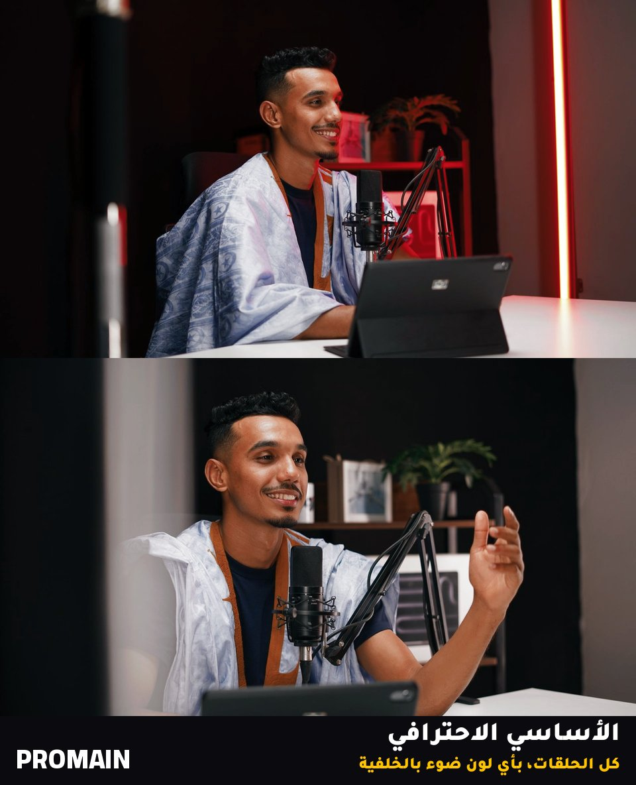
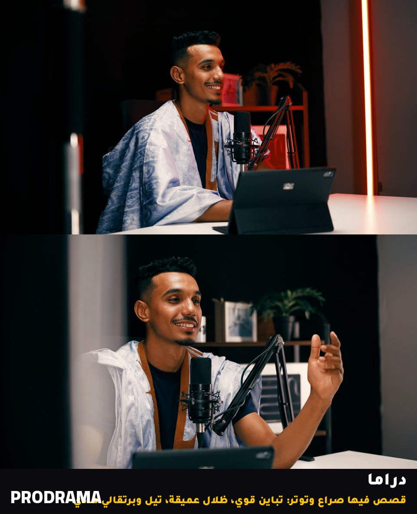
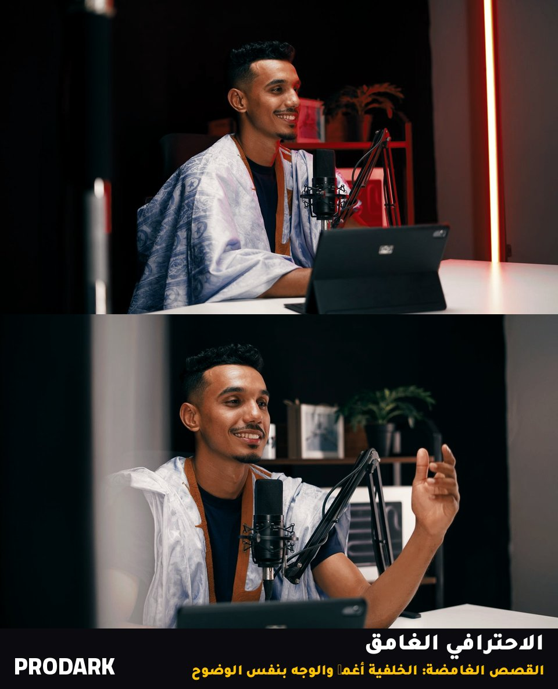
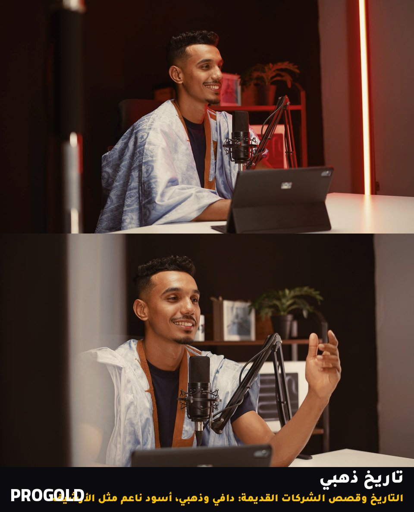
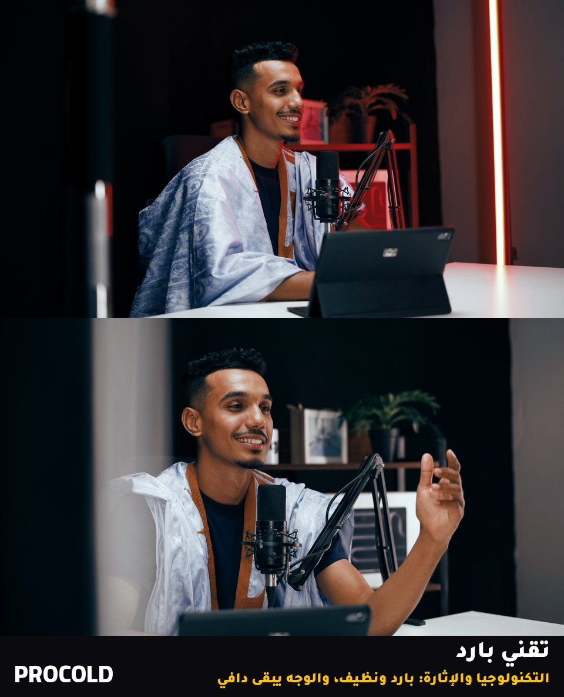
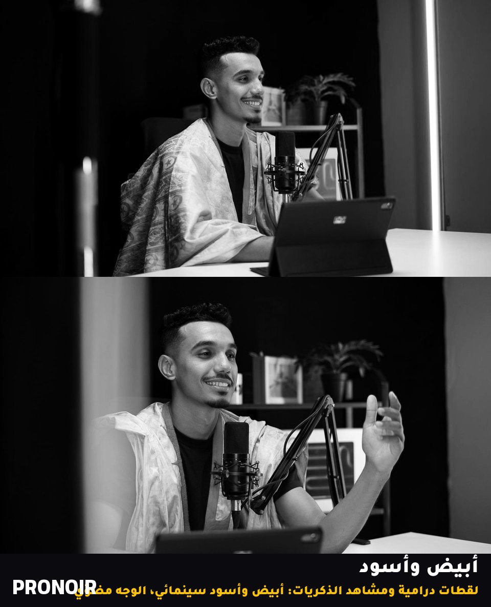

# فلاتر الكاميرا (Sony ZV-E10 II)

**7 ستايلات احترافية بس.** كل واحد "شكل" سينمائي كامل (وثائقي، فيلم، دراما، غموض...)، مو فلتر لون.
تحطهم بالكاميرا، تختار الستايل الي يناسب القصة، تصوّر، والفيديو يطلع **جاهز للنشر**: تقص وتنزل، بلا تصحيح ألوان.

> **شنو يعني LUT (فلتر)؟** ملف صغير يگول للكاميرا: "هذا اللون حوله لهذا اللون". الكاميرا تطبعه داخل الفيديو وقت التصوير.

## شلون انصنعت (25 تشرين الثاني 2026)

- **وجهك أول شي، بكل الستايلات:** لون البشرة يرجع لخطها الطبيعي، والضوء الملوّن الخفيف الطالع على وجهك يهدى. فتگدر تغيّر ضوء الخلفية لأي لون (أحمر، أزرق، بنفسجي، أبيض) والوجه يبقى وجهك.
- **التفاصيل:** الظلال ما تنسحق، فاللحية والحواجب والعيون تبقى واضحة. والأبيض القوي ينطفي بنعومة، مو يحترگ.
- **الستايل** يجي من الشكل نفسه: المنحنى (التباين)، وكثافة الألوان مثل شريط الفيلم، ولون الظلال والإضاءات. مثل ما يسوي ملوّن الأفلام بالدافنشي.
- انضبطت على صور من كاميرتك (ضوء أحمر، وضوء أزرق وكهرماني)، وعلى نسخة بنفسجية، وعلى صورة استوديو ثانية.


*(صور المعاينة من موقع Pexels المجاني، ومطبّق عليها الفلتر بالحساب.)*

---

## 1) السبعة (كل واحد ويا صورته)

| الصورة | الملف | الستايل | متى | مكانه |
|---|---|---|---|---|
| <a href="previews/PROMAIN.jpg"></a> | `PROMAIN` | **وثائقي** | الأساسي لكل الحلقات: نظيف وغني مثل وثائقيات نتفلكس | PPLUT1 |
| <a href="previews/PROFILM.jpg"></a> | `PROFILM` | **فيلم سينما** | قصص كبيرة ومقدمات: شكل شريط سينما، ألوان كثيفة وإضاءات ناعمة | PPLUT2 |
| <a href="previews/PRODRAMA.jpg"></a> | `PRODRAMA` | **دراما** | قصص بيها صراع وتوتر: تباين قوي وظلال عميقة | PPLUT3 |
| <a href="previews/PRODARK.jpg"></a> | `PRODARK` | **غموض وجريمة** | الجرائم والأسرار: ظلال خضرة باردة، وإضاءات صفرة، وألوان مكتومة | PPLUT4 |
| <a href="previews/PROGOLD.jpg"></a> | `PROGOLD` | **تاريخ ذهبي** | التاريخ وقصص الشركات القديمة: دافي وذهبي مثل الأرشيف | User |
| <a href="previews/PROCOLD.jpg"></a> | `PROCOLD` | **تقني بارد** | التكنولوجيا والإثارة: بارد ونظيف، والوجه يبقى دافي | User |
| <a href="previews/PRONOIR.jpg"></a> | `PRONOIR` | **أبيض وأسود** | لقطات درامية ومشاهد الذكريات | User |

- الكاميرا تختار **4 للتصوير السريع** (PPLUT1 لحد 4)، والباقي تحطهم بأماكن User وتبدّلهم وقت ما تريد.
- **ما تعرف شتختار؟** `PROMAIN` دائماً. هو الأساسي، والباقي حسب مزاج القصة.
- الفلاتر القديمة (42) انتقلت لمجلد `luts/archive`. **لا تحطها بالكاميرا.** امسح القديمة من الكاميرا وحط السبعة.

> ❗ **الفلتر ما يشتغل إلا بالوضع اليدوي.** بصورك الكاميرا چانت على الأوتوماتيكي (علامة **i** الخضرة)، وبيه الفلاتر تنطفي، والكاميرا تختار غالق بطيء (1/25) يمسح تفاصيل الوجه.
> حوّل لوضع الفيديو **M**، وخلي: غالق **1/50**، ISO **ثابت**، توازن أبيض **يدوي**، و**AE Level Offset = 5/3EV** لكل فلتر.
>
> **حتى يطلع جاهز بلا تعديل:** ضوء وجهك **أبيض** (السوفت بوكس)، والضوء الملوّن **على الخلفية بس** وأضعف من وجهك.

## 2) إذا ردت فلتر جديد

گول لـClaude شنو الشكل الي تريده (مثلاً "شكل أفلام الحرب"). ينضاف للسبعة بنفس المحرك، فالوجه يبقى محمي.

---

## 3) ❗ الخطوة الجديدة: صوّر أفتح (هذا الي يشيل الحبوب)

سوني نفسها كاتبة بدليل الكاميرا: التصوير الخام (S-Log3، والفلاتر تشتغل عليه) **يبين بيه تشويش أكثر**، والحل إنك **تصوّر بإضاءة أفتح**.

الفلاتر الجديدة مبنية على هذا: كل فلتر ينزّل الإضاءة **وقفة وثلثين** (يعني الكاميرا لازم تاخذ تقريباً 3 مرات ضوء أكثر). الصورة تطلع بنفس السطوع، بس الحبوب أقل.

**شنو تسوي (مرة وحدة لكل فلتر، وقت ما تدخله):**
1. **MENU ← Exposure/Color ← Color/Tone ← Manage User LUTs ← Import/Edit**
2. اختار الفلتر، ادخل على **AE Level Offset** (تعويض الإضاءة لهذا الفلتر)، واختار **5/3EV**.

**ووقت التصوير:**
- الصورة غامقة؟ **قرّب السوفت بوكس أو قوّيه** لحد ما وجهك يبين مضبوط على الشاشة. هذا أحسن حل.
- ما عندك ضوء أكثر؟ افتح العدسة (أصغر رقم F). وآخر شي ارفع ISO.

> **حسب الحساب:** الحبوب تقل لأقل من النص بالخلفية والظلال، وتقل تقريباً الخُمس على الوجه (لأن الفلتر الجديد تباينه أقوى). هذا حساب مو قياس على كاميرتك: دزّ مقطع 10 ثواني ونتأكد.

---

## 4) نقل الفلاتر من موبايلك للكاميرا (تطبيق سوني الرسمي)

تطبيق سوني الرسمي **Creators' App** ينقل الفلاتر من موبايلك للكاميرا مباشرة، بلا كمبيوتر وبلا كارت.

1. نزّل السبع ملفات من مجلد `luts` على موبايلك (تنتهي بـ `.cube`).
2. افتح **Creators' App** واربط الكاميرا.
3. ادخل على الكاميرا بالتطبيق، وبعدين **Camera Settings** (إعدادات الكاميرا) ← **LUT Management** (إدارة الفلاتر).
4. اختار المكان (User1 مثلاً) واختار الملف من موبايلك. عيدها للسبعة.
5. **لا تنسى** تخلي **AE Level Offset = 5/3EV** لكل فلتر (القسم 3).

> إذا التطبيق ما بيّن خيار الفلاتر: حدّث التطبيق، وحدّث نظام الكاميرا من نفس التطبيق، وعيد المحاولة.

**الطريقة الثانية (الكارت):** حط الملفات بالكارت بهذا المسار بالضبط: `PRIVATE` ← `SONY` ← `PRO` ← `LUT`. بعدين بالكاميرا:
**MENU ← Exposure/Color ← Color/Tone ← Manage User LUTs ← Import/Edit**

---

## 5) شلون تخلي الفلتر "ينطبع" بالفيديو

1. تأكد إن **Log Shooting = Off**:
   **MENU ← Shooting ← Image Quality/Rec ← Log Shooting Setting ← Off**
2. روح **Picture Profile** واختار **PPLUT1**، دوس يمين العجلة.
3. اختار **Basic Look** واختار الفلتر.
4. نفس الشي لـ PPLUT2 و3 و4.

**الي أنصحك بيه:** PPLUT1 = `PROMAIN`، PPLUT2 = `PROFILM`، PPLUT3 = `PRODRAMA`، PPLUT4 = `PRODARK`. وتبدّلهم حسب القصة.

**وقت التصوير:** دوس زر **Fn** ← **Picture Profile** ← اختار PPLUT الي تريده. خلص.

> **مهم:** الفلتر يحفر بالفيديو، ما ينشال بعدين. فخلي الإضاءة صح قبل ما تصوّر.

---

## 6) إعدادات الاستوديو

| الإعداد | القيمة | ليش |
|---|---|---|
| نوع الملف (File Format) | **XAVC S 4K** | أعلى دقة. **مو HD** |
| الجودة (Record Setting) | مونتاج بالموبايل أو التابلت: **100M 4:2:0 8bit**. مونتاج بالكمبيوتر: **140M 4:2:2 10bit** | سوني تگول 4:2:2 10bit مصمم للكمبيوتر، وتشغيله بباقي الأجهزة محدود |
| الفريمات | **25p** | كهرباء العراق 50 هيرتز، حتى الضوء ما يرمش |
| سرعة الغالق | **1/50** | ضعف الفريمات. حركة طبيعية وبلا رمشة |
| الفتحة (F) | أصغر رقم بالعدسة | ضوء أكثر، وخلفية ضبابية حلوة |
| توازن الأبيض | يدوي **5600K** (أو رقم السوفت بوكس) | **لا تخليه أوتو** |
| ISO | **ثابت** على أقل رقم تسمح بيه الكاميرا ويا الفلتر. **مو أوتو** | كل ما يرتفع، الحبوب تزيد |
| الزيبرا | 70 | خطوط بس على الخدود = الإضاءة مضبوطة |

---

## 7) بعدها اكو حبوب أو الدقة تبين ضعيفة؟ افحص هاي

| الفحص | وين | الصح |
|---|---|---|
| دتشوف النسخة الصغيرة بالموبايل؟ الكاميرا تگدر تسجل وي كل فيديو نسخة صغيرة خفيفة (Proxy)، وإذا هي الي تنتقل للموبايل، الفيديو يبين ضعيف ومحبّب | **MENU ← Network ← Cnct./Remote Sht. ← Select on Cam & Send ← Sending Target** | **Original Only** (الأصلي بس) |
| نوع الملف | **MENU ← Shooting ← Image Quality/Rec ← File Format** | **XAVC S 4K** |
| ISO | عجلة الكاميرا (ISO) | رقم ثابت واطي، مو AUTO |
| AE Level Offset لكل فلتر | **Manage User LUTs ← Import/Edit** | **5/3EV** |
| تعويض ظلام الزوايا (يكبّر التشويش بأطراف الصورة) | **MENU ← Shooting ← Image Quality/Rec ← Lens Compensation ← Shading Comp.** | **Off** |
| ضوء الغرفة | الاستوديو | مطفي. والسوفت بوكس قريب من وجهك |

إذا سويتها كلها وبعدها اكو حبوب: دزّ مقطع 10 ثواني من التصوير، ونشوف الملف نفسه.

---

## 8) احفظ كل شي حتى ما تعيده كل مرة

1. ظبط كل الإعدادات فوق.
2. **MENU ← Shooting ← Shooting Mode ← Camera Set. Memory** واختار رقم:
   - **1** = الاستوديو ويا PROMAIN
   - **2** = الاستوديو ويا PRODRAMA
   - **3** = الاستوديو ويا PRODARK
3. كل ما تشغّل الكاميرا: اختار وضع **MR** واختار الرقم.

وتگدر تحفظ الإعدادات بموبايلك بالتطبيق نفسه (**Saving and applying camera settings**)، حتى لو صار شي بالكاميرا ترجعها.

---

## 9) الإضاءة (هي نص اللون)

- **السوفت بوكس:** على جنبك بزاوية 45 درجة، أعلى من عيونك شوية، **وقريب**. كل ما يقرب، الصورة تنظف.
- **أضواء RGB:** **على الخلفية بس**، وخليها أغمق من وجهك.
- **ألوان تمشي ويا الفلاتر:** أزرق وبنفسجي، أو تيل وبرتقالي.
- **اطفي ضوء الغرفة.** يخلط الألوان ويخرّب الفلتر.

**من صورة استوديوك الحقيقية (10 تشرين الثاني 2026):**
- الضوء الأحمر مغرّگ الحايط الأبيض الي وراك، وطالع على خدودك. خفّف قوته، أو بعّده عن الحايط.
- الحايط وراك أفتح من وجهك. لازم العكس: قوّي ضوء الوجه أو قرّبه.
- الصورة مموّهة شوية (تفاصيل اللحية والحواجب ممسوحة). هذا يصير من حساسية ISO عالية، أو من النسخة الصغيرة (القسم 7).
- إذا تگدر، خلي لون ثاني بارد (أزرق أو تيل) على جوانب الاستوديو. الأحمر ويا الأزرق يطلع سينمائي.

---

## 10) أحسن الفلاتر الجاهزة بالسوق (بحث 10 تشرين الثاني 2026)

كلها لازم تكون **S-Log3 / S-Gamut3.Cine** وبحجم **33**، وبالنسخة المكتوب عليها "للكاميرا" أو "Monitoring" (مو نسخة المونتاج).
**لا ترفع أي فلتر جاهز بالريبو** (عام والكل يشوفه، وأصحابها ما يسمحون).

| الفلتر | السعر (حسب الموقع) | شنو يميزه |
|---|---|---|
| **s709** و **709(800%)** | ببلاش، **موجودين داخل الكاميرا** (Select LUT) | ألوان سوني السينمائية الرسمية. جربهم أول |
| [فلاتر سوني الرسمية (LUT Gallery)](https://www.sony.co.uk/alphauniverse/lut-gallery) | ببلاش (يحتاج حساب سوني) | من مصورين سوني، وكاميرتك مذكورة بالصفحة |
| [فلاتر Alister Chapman](https://www.xdcam-user.com/picture-settings-and-luts/alisters-free-luts/) | ببلاش (التبرع اختياري) | 15 ستايل سينمائي من خبير سوني معروف. خذ نسخة 33 |
| [Phantom LUTs](https://www.joelfamularo.com/colour-a7s3) | 49$ للمجموعة، 79$ للكل | الأشهر. ألوان مثل كاميرات السينما. كاميرتك ويا مجموعة FX6 |
| [Gerald Undone](https://www.geraldundone.com/luts/p/sony-s-log3-lut-pack) | 28.99$ | ألوان دقيقة وطبيعية (مو ستايل)، وبيه مجلد خاص لـ ZV-E10 II |
| [Cinema Tools](https://www.cinematools.co/utility) | 19.95$ | نسخة خاصة للكاميرا، وبيها نسخة "ناقص وقفتين" لتقليل الحبوب (نفس فكرتنا) |

**ليش فلاترنا أنسب إلك؟** مصنوعة لاستوديو صغير بضوء ملوّن، وبيها تقليل الحبوب جاهز، وببلاش، ونعدّلها مثل ما تريد. إذا اشتريت حزمة، دزّ الملفات لـClaude، يفحصها ويگلك أي منها يشتغل بكاميرتك.

---

## 11) قاموس الكاميرا (الكلمات الإنگليزية الي تشوفها)

| تشوف بالكاميرا | يعني |
|---|---|
| MENU | القائمة |
| Shooting | التصوير |
| Exposure/Color | الإضاءة والألوان |
| Color/Tone | اللون والدرجة |
| Network | الشبكة والاتصال |
| Setup | الإعدادات العامة |
| Picture Profile | ستايل الصورة |
| Manage User LUTs | إدارة فلاترك |
| Import/Edit | إدخال وتعديل |
| AE Level Offset | تعويض الإضاءة لهذا الفلتر |
| Select LUT | اختيار الفلتر |
| Display LUT | عرض الفلتر على الشاشة |
| Basic Look | الفلتر الأساسي |
| Log Shooting | التصوير الخام |
| White Balance | توازن الأبيض |
| Shutter Speed | سرعة الغالق |
| Zebra | خطوط الإضاءة الزايدة |
| Camera Set. Memory | حفظ الإعدادات |
| Image Quality/Rec | الجودة والتسجيل |
| File Format | نوع الملف |
| Record Setting | جودة التسجيل |
| Frame Rate | عدد الفريمات |
| Proxy | نسخة صغيرة خفيفة من الفيديو |
| Sending Target | أي نسخة تنتقل للموبايل |
| Original Only | الأصلي بس |
| Lens Compensation | تصحيح العدسة |
| Shading Comp. | تعويض ظلام الزوايا |
| On / Off | شغّال / طافي |

---

## 12) تريد فلتر جديد أو تعدّل واحد؟

گول لـClaude: "سوّيلي فلتر أدفى" أو "خلي ABNEON أقوى". يعدّل `scripts/make-luts.py` ويشغّل:

```bash
python3 scripts/make-luts.py --preview
python3 scripts/make-luts.py --mine صورة.png   # يطبق كل الفلاتر على صورة من استوديوك
```

**أحسن طريقة:** صوّر 10 ثواني بالاستوديو بأي فلتر ودزّهم. نشوف الحبوب والألوان على الملف نفسه ونضبط الفلاتر على وجهك.

**ملاحظات لـClaude (تقنية):**
- صاحب القناة يريد الفلاتر **قوية**، وويا كل فلتر **صورة** (گالها 10 تشرين الثاني 2026).
- **(25 تشرين الثاني 2026) يريد 5-10 ستايلات بس، كل واحد شكل احترافي كامل (وثائقي، دراما...)، مو فلاتر مربوطة بلون ضوء.** يغيّر لون الخلفية حسب القصة، ويريد الفيديو جاهز بلا تلوين. المجموعة بـ`PRO_SET`، والقديمة تنكتب بـ`luts/archive`.
- كل الفلاتر تنزّل الإضاءة `EXPO = 5/3` وقفة. إذا تغيّر الرقم، لازم يتغيّر AE Level Offset بهذا الدليل.
- مستوى ناتج الفلتر (`BLACK_OUT`، `WHITE_OUT`) مختار "بالنص" لأن محد وثّق شلون هاي الكاميرا تقرا الناتج. إذا گال إن **الأسود طالع رمادي وباهت**: خليهم `0.0` و`1.0`. إذا وصل مقطع من الكاميرا: قيس الأسود بالملف، وإذا ثبت إنه مستوى فيديو خليهم `64/1023` و`940/1023`.
- صور المعاينة تنصنع من `studio/camera/scenes/` (ثلاث صور من Pexels، ترخيص مجاني).
- المعاينة على صور استوديوه (`--mine`) تنحفظ بـ `studio/camera/private/` **وما تنرفع** (بيها وجهه والريبو عام). دزها إله مباشرة.
- كل `PRO_SET` يستخدم `pro_color` ويا `FACE` (البشرة أول، والضوء الملوّن الخفيف يهدى، وأضواء الخلفية تغنى بأي لون). صور قبل وبعد على وجهه ما تنرفع.
- استوديوه: ضوء أحمر قوي على حايط أبيض، وألواح خشب غامقة بالجوانب، وشرايط ضوء أبيض. يغيّر لون ضوء الخلفية حسب القصة.
