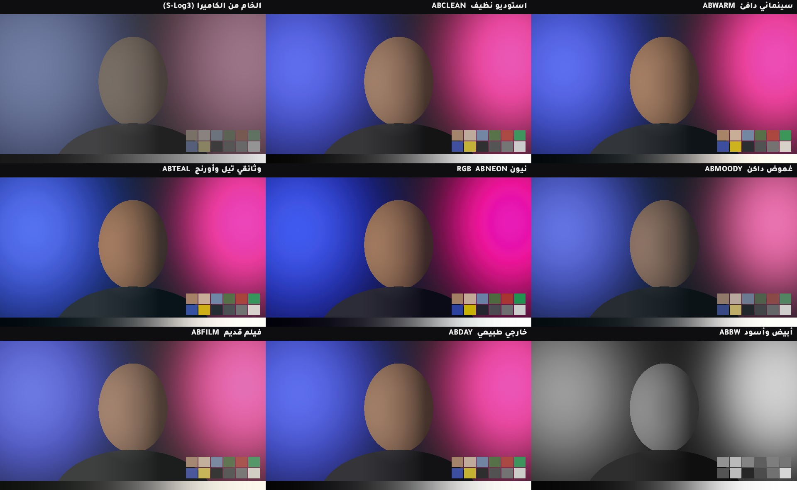

# فلاتر الكاميرا (Sony ZV-E10 II)

8 فلاتر خاصة إلك، مصنوعة بالحساب الدقيق لألوان سوني. تحطها بالكاميرا مرة وحدة، وتصوّر، والفيديو يطلع **ملوّن وجاهز** بدون مونتاج ألوان.

> **شنو يعني LUT؟** ملف صغير يگول للكاميرا: "هذا اللون حوله لهذا اللون". مثل فلتر انستا، بس احترافي وداخل الكاميرا.


*(الصورة مرسومة بالكمبيوتر للمقارنة. النتيجة الحقيقية تبين أحلى على وجهك.)*

---

## 1) الفلاتر ومتى تستخدم كل واحد

| الملف | الاسم | وين تستخدمه |
|---|---|---|
| `ABCLEAN` | استوديو نظيف | الحچي اليومي بالاستوديو. ألوان طبيعية ووجه نظيف. **ابدأ بيه.** |
| `ABWARM` | سينمائي دافئ | قصص الشركات والحلقات الطويلة. دفا خفيف مثل الأفلام. |
| `ABTEAL` | وثائقي تيل وأورنج | الوثائقيات. البشرة دافية والخلفية مايلة للأزرق المخضر. |
| `ABNEON` | نيون RGB | لما أضواء الـRGB وراك شغالة. يقوي ألوانها ويحمي لون وجهك. |
| `ABMOODY` | غموض داكن | حلقات الأسرار والجرائم والقصص المظلمة. |
| `ABFILM` | فيلم قديم | قصص تاريخية وذكريات. أسود ناعم مثل الفيلم. |
| `ABDAY` | خارجي طبيعي | التصوير برا بالشمس. يحمي السما من الاحتراق. |
| `ABBW` | أبيض وأسود | لقطات درامية أو مقاطع قصيرة مميزة. |

---

## 2) شلون تحط الفلاتر بالكاميرا (مرة وحدة بس)

1. نزّل ملفات `.cube` من مجلد `luts`.
2. حط الكارت بالكمبيوتر، وسوّي هذا المسار بالكارت بالضبط:
   `PRIVATE` ← `SONY` ← `PRO` ← `LUT`
   وانسخ الملفات داخل `LUT`.
3. رجّع الكارت للكاميرا، وروح:
   **MENU ← (Exposure/Color) ← Color/Tone ← Manage User LUTs ← Import/Edit**
4. اختار **User1** واختار `ABCLEAN`. بعدين **User2** ويا `ABWARM`... لحد ما تخلص الثمانية.

## 3) شلون تخلي الفلتر "ينطبع" بالفيديو

الكاميرا عدها 4 أماكن (PPLUT1 لحد PPLUT4) تطبع الفلتر داخل الفيديو وانت تصوّر.

1. أول شي تأكد إن **Log Shooting = Off**:
   **MENU ← (Shooting) ← Image Quality/Rec ← Log Shooting Setting ← Off**
2. روح **Picture Profile** واختار **PPLUT1**، دوس يمين العجلة.
3. اختار **Basic Look** واختار الفلتر.
4. نفس الشي لـ PPLUT2 و3 و4.

**الأربعة الي أنصحك بيهم:**
- PPLUT1 = `ABCLEAN` (اليومي)
- PPLUT2 = `ABWARM` (قصص)
- PPLUT3 = `ABNEON` (أضواء RGB)
- PPLUT4 = `ABMOODY` (غموض)

الباقين محفوظين بالكاميرا، تبدلهم وقت ما تريد.

> **مهم:** الفلتر يحفر بالفيديو، ما ينشال بعدين. فخلي الإضاءة صح قبل ما تصوّر.

---

## 4) إعدادات الاستوديو (اكتبها مرة وحدة)

| الإعداد | القيمة | ليش |
|---|---|---|
| الجودة | XAVC S 4K، 10bit 4:2:2 | أعلى جودة ألوان بالكاميرا |
| الفريمات | **25p** | كهرباء العراق 50 هيرتز، حتى الضوء ما يرمش |
| سرعة الغالق | **1/50** | ضعف الفريمات. حركة طبيعية وبلا رمشة |
| الفتحة (F) | أصغر رقم بالعدسة (مثلاً F2.8) | خلفية ضبابية حلوة |
| توازن الأبيض | يدوي **5600K** (أو رقم السوفت بوكس) | **لا تخليه أوتو.** الأوتو يلعب بلون وجهك |
| ISO | أقل رقم تسمح بيه الكاميرا | أقل تشويش |
| الزيبرا | 70 | لما تبين خطوط على وجهك بس بالخدود = الإضاءة مضبوطة |

> إذا الكاميرا ما خلتك تنزل الـISO كلش ويا PPLUT، هذا طبيعي. نزّل إضاءة السوفت بوكس بدال ما ترفع الـISO.

**الصورة غامقة أو فاتحة ويا فلتر معيّن؟** من **Manage User LUTs** اختار الفلتر وعدّل **AE Level Offset** (+1/3 أو +2/3). يحفظه لكل فلتر لحاله.

---

## 5) احفظ كل شي حتى ما تعيده كل مرة

1. ظبط كل الإعدادات فوق.
2. روح: **MENU ← (Shooting) ← Shooting Mode ← Camera Set. Memory** واختار **1**.
3. احفظ:
   - رقم **1** = الاستوديو ويا ABCLEAN
   - رقم **2** = الاستوديو ويا ABNEON (أضواء RGB شغالة)
   - رقم **3** = برا بالشمس ويا ABDAY
4. كل ما تشغّل الكاميرا: اختار وضع **MR (Cam.Set)** واختار الرقم. خلص، كل شي يرجع مثل ما حفظته.

---

## 6) الإضاءة (هي نص اللون)

- **السوفت بوكس:** على يمينك أو يسارك بزاوية 45 درجة، أعلى من عيونك شوية.
- **أضواء RGB:** **على الخلفية بس**، مو على وجهك. خليها أغمق من وجهك.
- **ألوان تمشي ويا الفلاتر:** أزرق وبنفسجي، أو تيل وبرتقالي. الأحمر القوي يصبغ الوجه.
- **اطفي ضوء الغرفة** (اللمبة البيضة أو الصفرة). تخلط الألوان وتخرّب الفلتر.

---

## 7) عن الفلاتر المدفوعة (بصراحة)

- أغلب الفلاتر المدفوعة مصنوعة **للمونتاج**، مو للكاميرا. حتى تشتغل بكاميرتك لازم تكون:
  مدخلها **S-Log3 / S-Gamut3.Cine**، وحجمها **33** أو **17** نقطة، وأقل من **1 ميگا**. فلاترنا كلها هيج.
- إذا تريد تشتري، أشهر نظام مدفوع هو **Leeming LUT Pro** (يصحح ألوان سوني، بس يستخدم بالمونتاج).
- سوني عدها فلاتر رسمية مجانية بمعرض اسمه **LUT Gallery**، تجربها إذا تحب.

## 8) تريد فلتر جديد أو تعدّل واحد؟

گول لـClaude: "سوّيلي فلتر أدفى" أو "خلي ABNEON أقوى". هو يعدّل الملف `scripts/make-luts.py` ويشغّل:

```bash
python3 scripts/make-luts.py --preview
```

**أحسن طريقة:** صوّر 10 ثواني بـ **S-Log3** (Log Shooting = On) ودزّ الفيديو. نطبق عليه الفلاتر ونختار الأحلى على وجهك.
